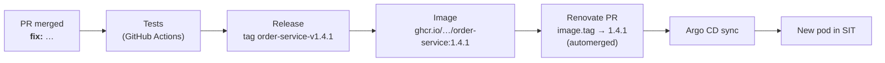
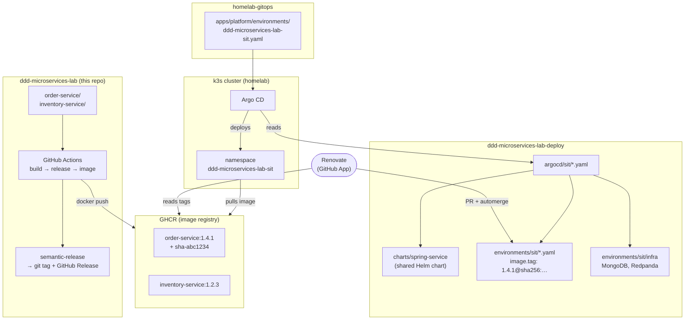
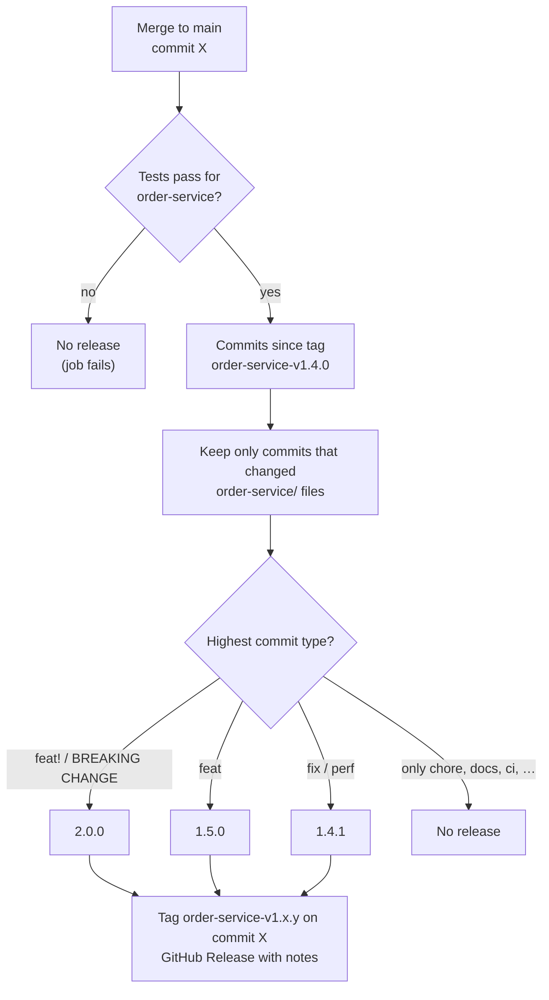
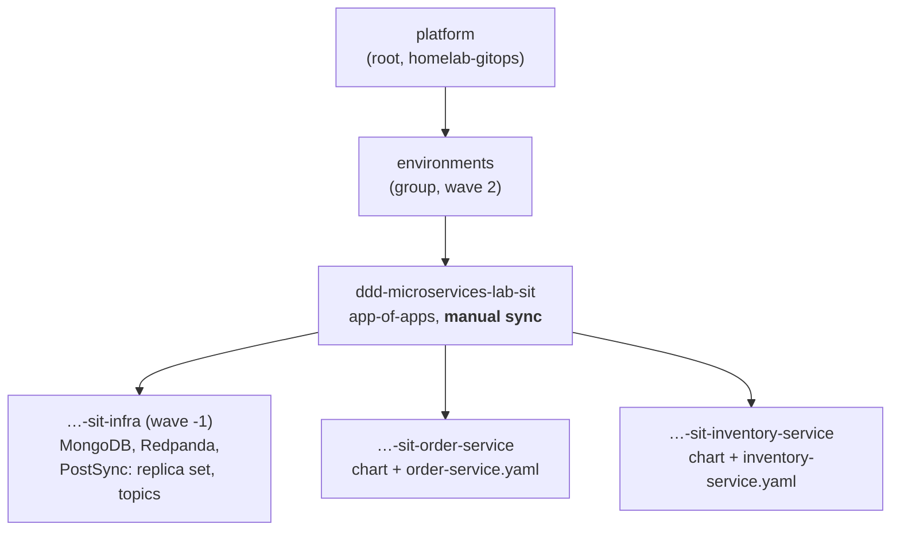
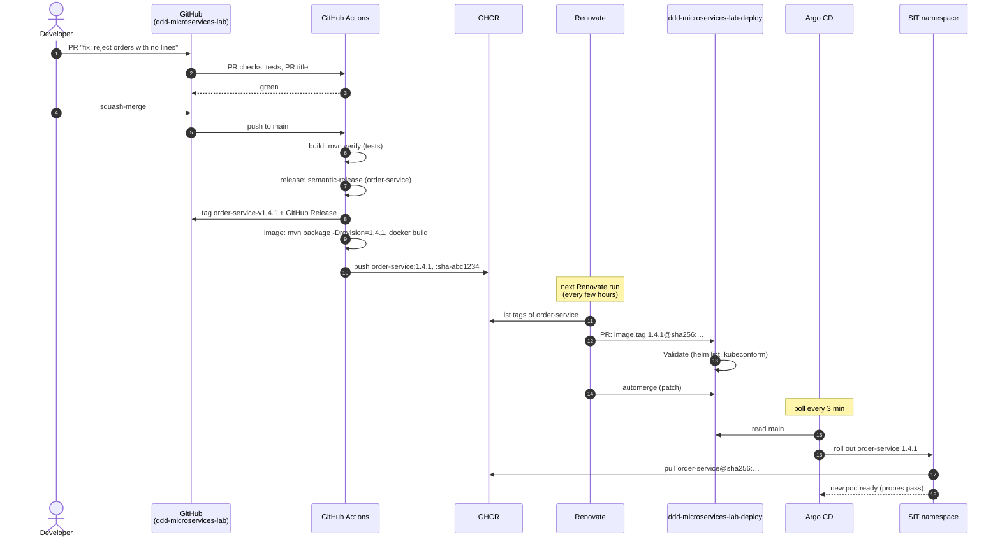
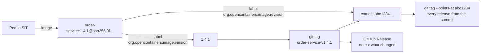
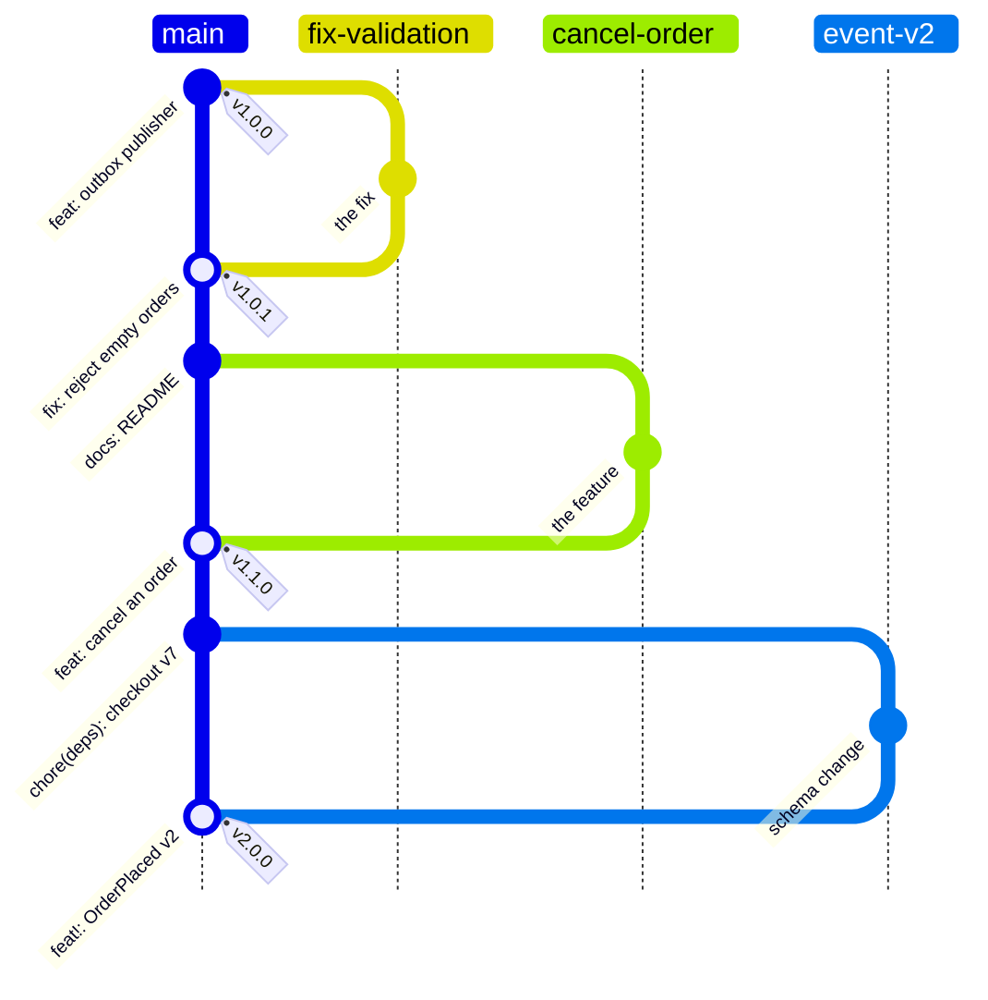
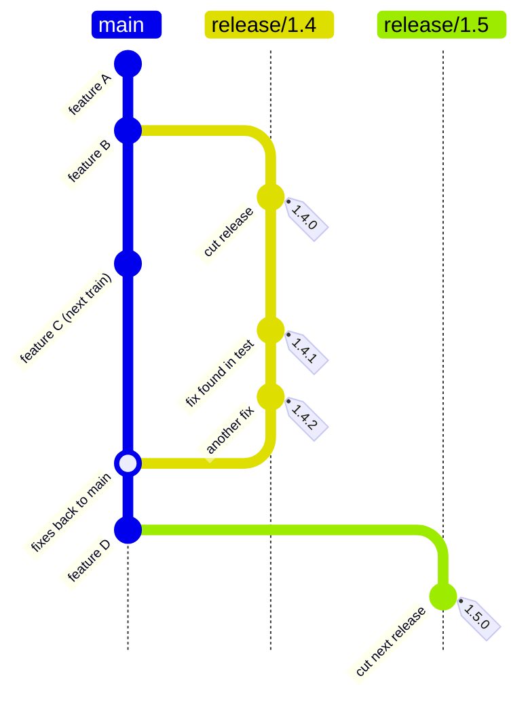

# Release and delivery

How a change to this repository becomes a numbered release, a container image, and a running deployment in the
SIT (system integration test) environment on the homelab Kubernetes cluster. Everything here runs on free tooling
for public repositories: GitHub Actions, GitHub Container Registry (GHCR), semantic-release, Renovate and Argo CD.

**Contents**

1. [The short version](#1-the-short-version)
2. [The pieces and where they live](#2-the-pieces-and-where-they-live)
3. [Step 1: from merge to release](#3-step-1-from-merge-to-release)
4. [Step 2: from release to image](#4-step-2-from-release-to-image)
5. [Step 3: from image to SIT](#5-step-3-from-image-to-sit)
6. [The whole journey, in time order](#6-the-whole-journey-in-time-order)
7. [Tracing a running pod back to its source](#7-tracing-a-running-pod-back-to-its-source)
8. [Two ways to release: continuous delivery and release trains](#8-two-ways-to-release-continuous-delivery-and-release-trains)
9. [Everyday tasks](#9-everyday-tasks)
10. [Troubleshooting](#10-troubleshooting)
11. [Reference](#11-reference)

---

## 1. The short version

- **Every merge to `main` whose PR title starts `feat:` or `fix:` releases the services it changed.** Nobody
  decides when to release; the PR title decides *whether* and *how much*.
- **Each service has its own version** (`order-service` 1.4.0, `inventory-service` 1.2.3), worked out from the
  [Conventional Commits](https://www.conventionalcommits.org/) that touched its folder, in
  [Semantic Versioning](https://semver.org/) form.
- **A release is a git tag** (`order-service-v1.4.0`) **plus a container image** with the same version
  (`ghcr.io/dafywinf/order-service:1.4.0`).
- **Renovate** watches the image registry and updates the deployment repository; **Argo CD** deploys what that
  repository says. Minor and patch releases reach SIT with no human step; major releases wait for approval.



---

## 2. The pieces and where they live



| Piece | Repository / place | Job |
|---|---|---|
| Service code and tests | `ddd-microservices-lab` | What gets built |
| GitHub Actions workflows | `ddd-microservices-lab/.github/workflows/*-service-ci.yml` | Test, release, build and push the image |
| semantic-release | `ddd-microservices-lab/release.config.mjs`, `release/` | Decide the next version, tag it, write release notes |
| PR title check | `ddd-microservices-lab/.github/workflows/pr-title.yml` | Make sure every merge commit is a valid Conventional Commit |
| GHCR | `ghcr.io/dafywinf/<service>` | Store the images (public, free) |
| Deployment configuration | `ddd-microservices-lab-deploy` | Which version runs where, the Helm chart, SIT's MongoDB and Redpanda |
| Renovate | GitHub App on both repos | Notice new releases and update the deployment configuration |
| Argo CD registration | `homelab-gitops/apps/platform/environments/` | Tell the cluster's Argo CD that SIT exists |
| Argo CD | k3s cluster | Make the cluster match `ddd-microservices-lab-deploy` |

**Why the deployment configuration has its own repository:** a version bump by Renovate is a commit; in this repo it
would trigger builds and, worse, could be mistaken for a code change. Kept separate, the code repo's history is
about code, the deploy repo's history is an exact record of what ran in SIT and when, and one deploy repo can deploy
services from several code repos.

---

## 3. Step 1: from merge to release

### 3.1 The PR title is the commit message

PRs are **squash-merged**, and the repository is set to use the **PR title** as the commit message. So the PR title
is the one line semantic-release reads. The `PR title` check fails any PR whose title is not a Conventional Commit.

### 3.2 What each commit type does

| PR title starts with | Example | Release |
|---|---|---|
| `fix:` | `fix: reject orders with no lines` | **patch**: 1.4.0 → 1.4.**1** |
| `fix(deps):` | Renovate: `fix(deps): update spring-boot to 4.2.1` | **patch** (runtime libraries changed) |
| `perf:` | `perf: cache stock look-ups` | **patch** |
| `feat:` | `feat: cancel an order` | **minor**: 1.4.1 → 1.**5**.0 |
| `feat!:` or a `BREAKING CHANGE:` footer | `feat!: OrderPlaced v2 event` | **major**: 1.5.0 → **2**.0.0 |
| `chore:` `docs:` `ci:` `test:` `refactor:` `build:` `style:` | `chore(deps): update actions/checkout` | **none** |

A scope in brackets (`fix(order):`) is optional and only shows in the release notes.

### 3.3 One version line per service

Both services live in one repository but are versioned separately. For each service, semantic-release only looks at
commits that **changed a file in that service's folder**: a `fix:` touching `order-service/` releases order-service
and leaves inventory-service alone. A commit that touches both folders releases both, so one commit can carry two
tags (as `order-service-v1.1.0` and `inventory-service-v1.1.0` both do).



This filtering is done by `release/service-commits.mjs`, about twenty lines wrapping semantic-release's standard
commit analyser and release-notes generator. (The well-known `semantic-release-monorepo` plugin did the same but has
been unmaintained since 2024.)

### 3.4 The git tag is the only record of the version

Nothing is committed back to `main`: the poms say `<version>${revision}</version>` with `revision` defaulting to
`0.0.0-SNAPSHOT`. The release build passes the version in (`mvn package -Drevision=1.4.1`). This avoids release
commits on `main`, a token allowed to push to `main`, and two places that could disagree about the version.

### 3.5 Where this runs

Each service's workflow (`order-service-ci.yml`, `inventory-service-ci.yml`) has three jobs:

| Job | Runs on | Does |
|---|---|---|
| `build` | every push and PR touching the service | `mvn clean verify`: all unit and Testcontainers tests |
| `release` | `main` only, after `build` passes | `npx semantic-release` with `SERVICE=<folder>`; outputs the new version, if any |
| `image` | after `release`, only if it released (or a manual rebuild) | See step 2 |

On PRs and other branches, `release` and `image` show as **skipping**. Releases for one service run one at a time
(`concurrency`), so two quick merges cannot claim the same version.

---

## 4. Step 2: from release to image

The tag names the code; the **image** is the runnable thing. Kubernetes cannot run a git tag, and Renovate and Argo CD
only ever look at the registry.

The `image` job:

1. checks out **the release tag**, not the tip of `main` (another merge may have landed meanwhile);
2. runs `mvn package -DskipTests -Drevision=<version>` (the tests passed for this commit in `build`), giving
   `order-service-1.4.1.jar` with `Implementation-Version: 1.4.1`;
3. builds `<service>/docker/Dockerfile` (`eclipse-temurin:25-jre`, the same JDK as CI and local builds);
4. pushes two tags of **the same image**:
   - `ghcr.io/dafywinf/order-service:1.4.1`: the one the deploy repo and Renovate use;
   - `ghcr.io/dafywinf/order-service:sha-abc1234`: look-up by commit;
5. labels it (OCI annotations): `org.opencontainers.image.version`, `.revision` (full commit hash), `.source` (this
   repository, which also links the GHCR package to it).

**Why it is a job in the same workflow run, not a separate workflow triggered by the tag:** anything a workflow does
with its built-in `GITHUB_TOKEN`, including pushing a tag, deliberately does not trigger other workflows (to prevent
loops). The `release` job passes the version to `image` through a job output instead.

**Why the version is not in the image tag twice, e.g. `1.4.1-abc1234`:** in SemVer a hyphen marks a *pre-release*
(`1.4.1-abc1234` sorts *before* `1.4.1`), and Renovate treats a Docker tag's hyphen suffix as a fixed flavour, so it
would never offer the next release. The commit is recorded in the `sha-` tag and the `revision` label instead.
(SemVer's place for build data is `+abc1234`, but Docker tags cannot contain `+`.)

---

## 5. Step 3: from image to SIT

### 5.1 Renovate

Renovate (the hosted GitHub App) runs against `ddd-microservices-lab-deploy` every few hours. Its `helm-values`
manager finds `image.repository` and `image.tag` in `environments/sit/*.yaml`, asks GHCR for that repository's tags,
and when a higher version exists:

1. opens a PR changing `image.tag` from `1.4.0@sha256:<old>` to `1.4.1@sha256:<new>` (version **and** digest);
2. waits for the deploy repo's **Validate** check (helm lint, render, kubeconform schema check);
3. **merges the PR itself** if the update is minor or patch. Major updates appear in the Dependency Dashboard issue
   and wait until you tick them.

Renovate looks at the **registry, not at git tags**. If it watched tags, it could switch SIT to a version whose image
was still being built, and the pod would fail with `ImagePullBackOff`. An image in the registry is the real signal
that a release is ready.

The **digest** (`sha256:…`) is a fingerprint of the image's contents. A tag is a name and could in theory be pushed
again; the digest cannot change. With both, the file stays readable and the cluster runs exactly the image that was
tested.

### 5.2 Argo CD



- `ddd-microservices-lab-sit` is registered in homelab-gitops but has **no automatic sync**: syncing it once switches
  SIT on.
- Its three children **do** sync automatically: when Renovate's merge changes `environments/sit/order-service.yaml`,
  Argo CD notices within its 3-minute poll and rolls out the new version.
- The services wait for MongoDB and Redpanda through readiness probes and retries; the infra application is in an
  earlier sync wave so it is created first.

### 5.3 What SIT contains

| Component | Image | Memory request / limit | Notes |
|---|---|---|---|
| order-service | `ghcr.io/dafywinf/order-service` | 384 Mi / 512 Mi | `https://order-service-sit.192-168-86-10.sslip.io` |
| inventory-service | `ghcr.io/dafywinf/inventory-service` | 384 Mi / 512 Mi | `https://inventory-service-sit.192-168-86-10.sslip.io`; scraped by Prometheus |
| MongoDB | `mongo:9.0.8` | 256 Mi / 512 Mi | One node as replica set `rs0` (the services use transactions); databases `orders` and `inventory_db` |
| Redpanda | `redpandadata/redpanda:v26.3.1` | 768 Mi / 1 Gi | Kafka API at `redpanda-0.redpanda:9092`; topics `orders.v1`, `inventory.v1` |

The same MongoDB and Redpanda versions are used by the Testcontainers tests (`TestImages.java`) and the local
Docker Compose platform (`platform/platform.yml`), so tests, local development and SIT run the same software.
Renovate updates all of them in one PR per image.

---

## 6. The whole journey, in time order



Typical timings: tests and release about 2 minutes; the image about 1 minute more; then up to a few hours until
Renovate's next run (tick its Dependency Dashboard to run it sooner); then up to 3 minutes for Argo CD.

---

## 7. Tracing a running pod back to its source



```sh
# Which image is running?
kubectl -n ddd-microservices-lab-sit get deploy order-service -o jsonpath='{.spec.template.spec.containers[0].image}'

# Which commit built it?
docker inspect ghcr.io/dafywinf/order-service:1.4.1 --format '{{index .Config.Labels "org.opencontainers.image.revision"}}'

# Which releases came from that commit?
git tag --points-at <commit>

# Which commit is a release?
git rev-list -n1 order-service-v1.4.1
```

---

## 8. Two ways to release: continuous delivery and release trains

There are two common ways to turn commits into versions. They answer different questions, and both are sound.

### 8.1 Continuous delivery (used here)

Every merge with a releasable change becomes a release straight away. The version is worked out from **what the
changes mean**: the Conventional Commit types say whether this is a fix, a feature or a breaking change. (In the
graph, `v1.0.1` stands for the real tag `order-service-v1.0.1`.)



- One long-lived branch, `main`. Short feature branches are merged into it.
- `fix:` → patch, `feat:` → minor, `feat!:` → major; `docs:` and `chore:` produce no release.
- The tool: semantic-release (or release-please, which asks for a "Release PR" to be merged first).

### 8.2 Release trains

Releases leave on a schedule, like trains. When it's time, a **release branch** is cut (`release/1.4`); the branch
fixes the major and minor numbers, and every build on it gets the next number, usually **counted from commits** since
the branch was cut. Only fixes go onto the release branch while it is tested; new work continues on `main` for the
next train.



- `1.4` comes from the branch name, chosen by a person when the train is cut; the last number counts builds on the
  branch (`git rev-list --count <branch-point>..HEAD`). Tools such as GitVersion do this; plain git also can.
- **Every build has a unique version**, so testers can refer to "build 1.4.23", and nightly builds are trivial.
- Often a commit hash is appended (`1.4.0-23-g1a2b3c4`, as `git describe` does) because the count alone does not
  identify a commit if history is rewritten or a CI checkout is shallow.

### 8.3 Compared

| | Continuous delivery (here) | Release trains |
|---|---|---|
| **When is there a release?** | On every merge with a `feat:`/`fix:` | When a train is cut, then each build on its branch |
| **Who decides major/minor?** | The change authors, through the PR title | A person, when cutting the release branch |
| **What does the patch number mean?** | "Only fixes since the last minor" | "The Nth build on this branch": says nothing about the kind of change |
| **Discipline needed** | Every PR title must be typed correctly | None in commit messages; discipline goes into branching |
| **Changelog** | Generated from the commit messages | Has to be written or assembled separately |
| **Branches** | `main` only | `main` plus a branch per release |
| **Fixing an older version** | Possible but unusual: you move forward | Natural: fix on `release/1.4` while `main` moves to 1.5 |
| **Every build gets a version?** | No, only releasable merges | Yes |
| **Fragility** | A wrongly typed title gives a wrong version | Counts break with shallow clones or rewritten history |
| **Works with automatic upgrades (Renovate)?** | Yes: "automerge minor and patch, hold major" is meaningful | Risky: a breaking change can arrive as a patch-sized number |
| **Suits** | Small, frequent, independent changes; one environment that should always be current | Coordinated releases, long test cycles, several supported versions in the field |

### 8.4 The decision for this project

**Continuous delivery.** SIT should always run the latest working version of each service, and each service should
be releasable on its own: independent deployability is one of the things this lab is about. Version numbers that
carry meaning are also what makes Renovate's automerge rule safe: patch and minor releases flow into SIT
automatically, and a breaking change (`feat!:`) produces a major version that waits for approval.

**Independent versions, not lockstep.** The two services could share one version (every release bumps both). That
would be simpler, but every release would redeploy both services, a version would no longer say which service
changed, and nothing would push the services to keep their event contracts compatible with each other's older
versions. The combination that ran together is recorded anyway: each commit to `ddd-microservices-lab-deploy` is an
exact list of the versions running in SIT.

---

## 9. Everyday tasks

### Choose a PR title

| You changed | Title |
|---|---|
| A bug in order-service | `fix: …` (optionally `fix(order): …`) |
| New behaviour | `feat: …` |
| Something that breaks other services or clients (event schema, API) | `feat!: …`, and describe the break in the PR body under `BREAKING CHANGE:` |
| Tests only | `test: …` |
| CI, build or release tooling | `ci: …` / `build: …` |
| Docs | `docs: …` |
| Code tidy-up with no behaviour change | `refactor: …` |

### Release without a code change

Every release must come from a commit. If you need a release (for example to pick up a new base image), merge a
`fix:` PR with the change (Renovate's `fix(deps):` PRs do this for library updates).

### Rebuild the image of an existing release

GitHub → Actions → *Order Service CI* (or *Inventory Service CI*) → **Run workflow**, version `1.4.1`. It checks out
tag `order-service-v1.4.1`, builds and pushes the image again. Releases before 1.1.0 cannot be rebuilt (their tags
predate the Dockerfile and the `${revision}` version).

### Deploy a release to SIT now

Open the Dependency Dashboard issue in `ddd-microservices-lab-deploy` and tick the update, or change `image.tag` in
`environments/sit/<service>.yaml` yourself (copy the version and digest from GHCR).

### Roll back SIT

Set `image.tag` back to the earlier `version@sha256:digest`. Renovate would immediately offer the newer release again,
so also hold it: close Renovate's PR for that version (closed PRs are not recreated for the same version), or add
`"allowedVersions": "!/^1\\.4\\.1$/"` for that image in the deploy repo's `renovate.json`. Fix forward with a new
`fix:` release.

### Add a new service

1. In this repo: a folder with a pom (`<version>${revision}</version>`), `docker/Dockerfile`, and a workflow copied
   from `order-service-ci.yml` with the folder names changed (its `release` job sets `SERVICE`).
2. In `ddd-microservices-lab-deploy`: `environments/sit/<service>.yaml` and `argocd/sit/<service>.yaml`.
3. The first `feat:`/`fix:` merge touching the folder releases 1.0.0.

### Run semantic-release locally (dry run)

```sh
npm ci
SERVICE=order-service GITHUB_TOKEN=$(gh auth token) npx semantic-release --dry-run --no-ci
```

It prints how many commits touch the folder, the next version and the release notes, without creating anything.
(Node 26 or newer; on an older Node: `npx -p node@26 -- npx semantic-release …`.)

---

## 10. Troubleshooting

| Symptom | Likely cause | What to do |
|---|---|---|
| Merged, but no release | Title was `chore:`/`docs:`/…; or the commit didn't touch the service's folder | Expected. The `release` job log says *"There are no relevant changes"* |
| PR blocked by **PR title** | Title isn't a Conventional Commit | Edit the title; the check re-runs |
| `release` job failed after creating the tag | A later step failed (e.g. the version output) | The release is complete; fix the job. A re-run finds nothing new to release |
| `release` job failed with a git or token error | `contents: write` permission missing, or history not fetched | The job needs `fetch-depth: 0` and `permissions: contents: write` |
| Release exists, no image | `image` job failed or was skipped | Check the job; then *Run workflow* with the version |
| `ImagePullBackOff` in SIT | Image not in GHCR, or the package is private | Check `ghcr.io/dafywinf/<service>` exists and is public |
| SIT still on the old version | Renovate hasn't run yet, Validate failed, or the update is a major | Dependency Dashboard: tick the update; check the PR's checks |
| Renovate PR open but not merged | Validate failed, or it's a major version | Fix the deploy repo, or approve the major |
| Argo CD shows OutOfSync for `ddd-microservices-lab-sit` | By design: it has no automatic sync | Sync it once to switch SIT on |
| Services crash-loop in SIT, Mongo errors | Replica set not initialised | Check the `mongo-init-replica-set` job's logs; re-sync the infra app to re-run it |

---

## 11. Reference

| File | Repository | Purpose |
|---|---|---|
| `release.config.mjs` | ddd-microservices-lab | semantic-release config; `SERVICE` picks the folder and tag prefix |
| `release/service-commits.mjs` | ddd-microservices-lab | Filters commits to the service's folder |
| `package.json`, `package-lock.json` | ddd-microservices-lab | semantic-release and plugins (Node 26) |
| `.github/workflows/*-service-ci.yml` | ddd-microservices-lab | `build`, `release`, `image` jobs; manual rebuild |
| `.github/workflows/pr-title.yml` | ddd-microservices-lab | Conventional Commit PR titles |
| `*/docker/Dockerfile` | ddd-microservices-lab | Image on `eclipse-temurin:25-jre` |
| `renovate.json` | ddd-microservices-lab | Dependency updates for the code; majors wait for approval |
| `charts/spring-service/` | ddd-microservices-lab-deploy | Shared Helm chart |
| `environments/sit/*.yaml` | ddd-microservices-lab-deploy | Versions and settings per service |
| `environments/sit/infra/` | ddd-microservices-lab-deploy | MongoDB, Redpanda and their PostSync jobs |
| `argocd/sit/` | ddd-microservices-lab-deploy | SIT's Argo CD Applications |
| `renovate.json` | ddd-microservices-lab-deploy | Automerge new service releases into SIT |
| `.github/workflows/validate.yml` | ddd-microservices-lab-deploy | The check Renovate waits for |
| `apps/platform/environments/ddd-microservices-lab-sit.yaml` | homelab-gitops | Registers SIT with Argo CD (manual sync) |

Repository settings that matter: in both code and deploy repositories, PRs are **squash-merged only** with the
**PR title** as the commit message.
